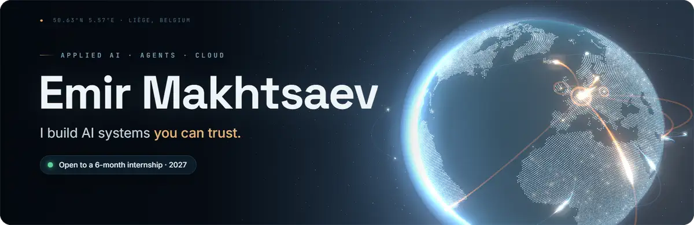

<p align="center">
  
</p>

<p align="center">
  <a href="https://www.linkedin.com/in/emir-makhtsaev-0b97283a0/"></a>
  
  
</p>

<br>

```python
emir = {
    "studying":    "BSc Computer Science, AI track @ HELMo (Liège)",
    "building":    ["RAG platforms", "AI agents", "data pipelines"],
    "next":        "Cloud certification, before 2027",
    "looking_for": "6-month internship in cloud & AI, early 2027",
}
```

## Featured work

<table>
  <tr>
    <td width="50%"><a href="https://github.com/ForgedEmir/RAG"></a></td>
    <td width="50%"><a href="https://github.com/ForgedEmir/PARALLAX"></a></td>
  </tr>
  <tr>
    <td width="50%"><a href="https://github.com/ForgedEmir/neuro-spark"></a></td>
    <td width="50%"><a href="https://github.com/ForgedEmir/CarWatch"></a></td>
  </tr>
</table>

## How I build

| | Principle | Where it shows |
|:-:|---|---|
| `01` | **Every answer has a source.** | The RAG platform answers from retrieved passages and cites them. |
| `02` | **The model perceives, rules decide.** | In PARALLAX, the AI never releases a workflow on its own. |
| `03` | **Reproducible or it didn't happen.** | NeuroSpark versions its data with DVC and tracks every run in MLflow. |
| `04` | **Every loop has a budget.** | My research agents run with hard limits on cost, requests and time. |

## Toolbox

<p>
  <picture>
    <source media="(prefers-color-scheme: light)" srcset="https://skillicons.dev/icons?i=python,fastapi,docker,postgres,redis,supabase,linux,ts,react,git,githubactions&theme=light">
    
  </picture>
</p>

<p>
  
  
  
  
  
  
  
</p>

<br>

<p align="center">
  <sub>Banner rendered frame by frame with <a href="banner/">Three.js</a> · Final year @ HELMo · Open to internships for 2027 · Let's talk on <a href="https://www.linkedin.com/in/emir-makhtsaev-0b97283a0/">LinkedIn</a></sub>
</p>
