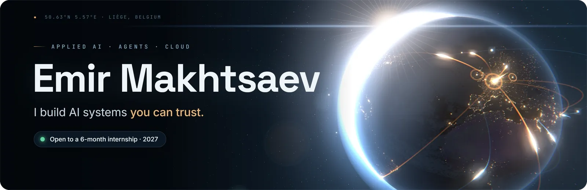
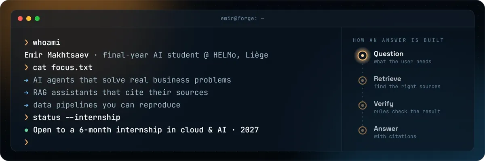
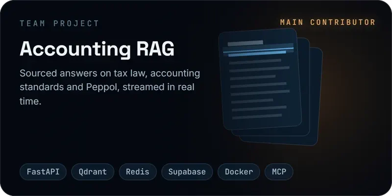
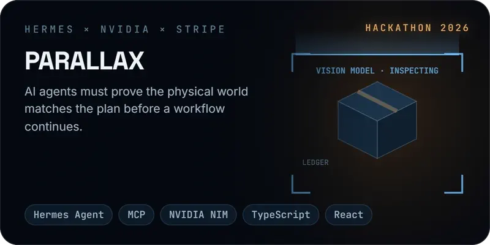
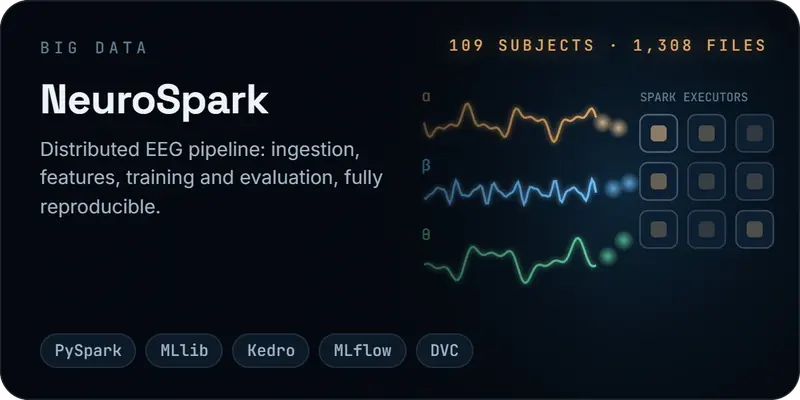
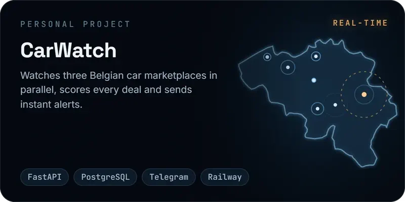
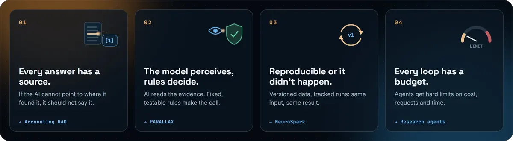
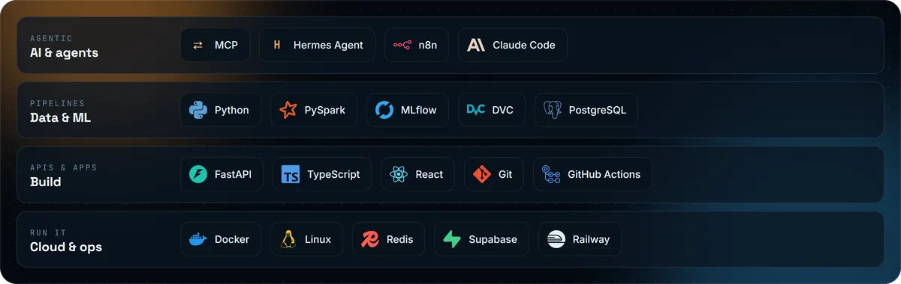

  

  
  
  

  

## Featured work

  
  
  
  

## How I build

  

## Toolbox

  

  Every visual on this page is rendered frame by frame with <a href="render/">Three.js and Canvas</a> · Final year @ HELMo · Open to internships for 2027 · Let's talk on <a href="https://www.linkedin.com/in/emir-makhtsaev-0b97283a0/">LinkedIn</a>

