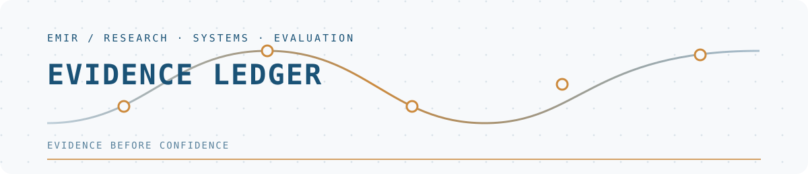

  <picture>
    <source media="(prefers-color-scheme: dark)" srcset="assets/header-dark.svg">
    
  </picture>

<h1 align="center">Evidence before confidence.</h1>

  From applied ML and retrieval systems to evidence-first agents. 
  I’m currently exploring how memory, tools, skills and evaluation can make agentic systems more reliable.

## Evidence ledger

| System | Public evidence | Status |
|---|---|---|
| **[RAG](https://github.com/ForgedEmir/RAG)** | Release, source code and documentation | Implemented |
| **[neuro-spark](https://github.com/ForgedEmir/neuro-spark)** | Pipeline, tests and DVC workflow | Academic project |
| **[diabetes-scan](https://github.com/ForgedEmir/diabetes-scan)** | Notebooks, reports and evaluation | Academic project |
| **[SourceLoom](https://github.com/ForgedEmir/SourceLoom)** | Architecture and decision records | Design phase |

## Selected work

- **[RAG](https://github.com/ForgedEmir/RAG)** — Hybrid retrieval for accounting-oriented documents, with SSE streaming, multi-user authentication, semantic caching and an MCP server.
- **[neuro-spark](https://github.com/ForgedEmir/neuro-spark)** — Distributed EEG motor-imagery processing with PySpark, frequency-band decomposition and MLlib classification.
- **[diabetes-scan](https://github.com/ForgedEmir/diabetes-scan)** — Early-stage diabetes risk prediction using nested cross-validation, SHAP explanations and fairness evaluation.
- **[CarWatch](https://github.com/ForgedEmir/CarWatch)** — Parallel Belgian used-car monitoring, deal scoring and Telegram alerts.
- **[peppol-prospector](https://github.com/ForgedEmir/peppol-prospector)** — CBE and Peppol directory cross-referencing for Belgian company research.

## Now investigating

**[SourceLoom — Adaptive Deep Research Engine](https://github.com/ForgedEmir/SourceLoom)** is currently in its foundation phase. The research question is whether explicit evidence gaps can drive better follow-up queries than a naive multi-provider merge.

- Evidence graphs and contradiction detection
- Bounded agent loops with explicit stopping rules
- Reproducible evaluation of memory, tools and skills

<strong>How I evaluate an experiment</strong>

 

1. Establish a reproducible baseline.
2. Define the budget, timeout and stopping conditions.
3. Run a small validation before a full benchmark.
4. Compare quality, cost and failure modes.
5. Publish limitations; “unknown” remains a valid result.

## Working principle

> Test before claiming. Bound every loop. Treat every concrete number as a hypothesis until its source is verified.

  Student in Belgium · Python · Applied AI · Agent evaluation

